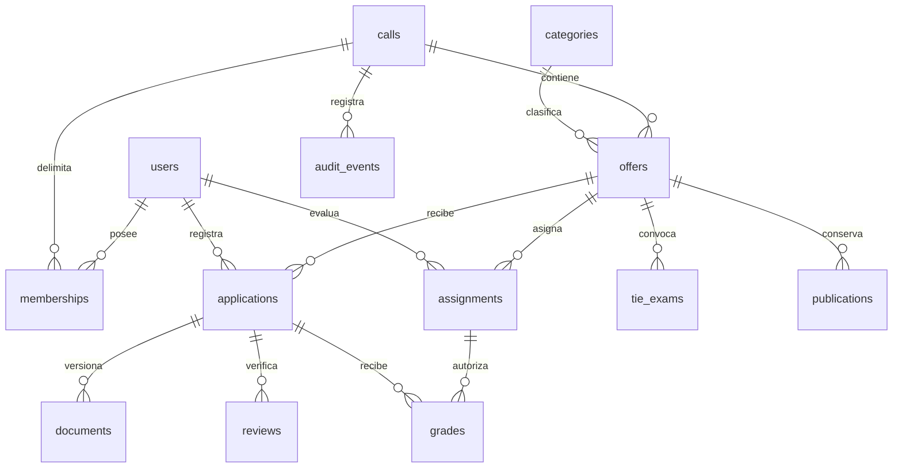
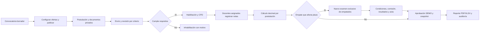
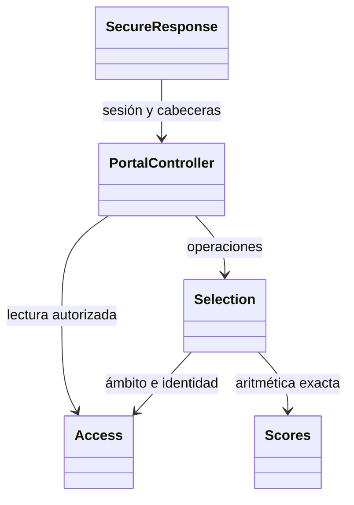
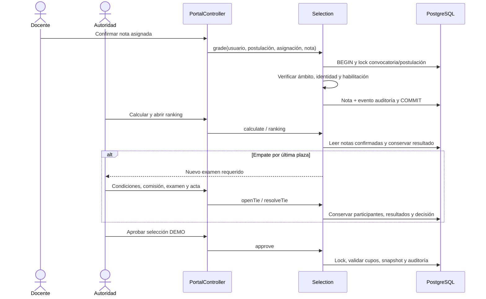

# Arquitectura de la primera versión ejecutable

Monolito modular Laravel 12 / PHP 8.3, PostgreSQL 15, vistas Blade y CSS local. El navegador no calcula notas ni decide permisos. No hay dependencia operativa de Node, Docker, API CPD o nube.

`PortalController`: formularios/validación HTTP y vistas. `Access`: permisos por convocatoria y propiedad. `Selection`: transacciones y reglas de negocio. `Scores`: decimal exacto, validación y redondeo. Migraciones: integridad referencial, unicidad y rangos CHECK de PostgreSQL. `SecureResponse`: cabeceras de seguridad y rechazo de cuentas inactivas. No se usa ocultación de botones como autorización.

## Relaciones principales

## Flujo operativo DEMO

## Transacciones, versiones y concurrencia

Se bloquea la fila de convocatoria antes de postulación/oferta/nota en las mutaciones del dominio. Esta serialización conservadora evita carreras de límite, cupo y publicación en la escala de la DEMO. Las restricciones únicas protegen persona/oferta, asignación de área y nota por asignación/postulación. Las pruebas `scripts/concurrency.py` usan dos procesos PHP independientes y conexiones PostgreSQL, no una base en memoria.

La publicación congela las ofertas de una convocatoria. Cada postulación guarda snapshot; cada resultado audita notas y pesos usados; aprobar conserva publicación inmutable para el portal. La versión actual no permite reemplazar silenciosamente publicaciones: rectificaciones posteriores requieren un futuro procedimiento de nueva versión. `.parent_id` permite relacionar convocatorias. Los históricos conservan ofertas distintas 01/02 y su fuente.

## Fórmula del fixture, no normativa de composición

Notas de áreas o de componentes sobre 100, pesos que suman 100: `examen = HALF_UP_2((Σ nota × porcentaje / 100) × 0.6)`; `final = mérito + examen`. Se usa BCMath con precisión interna de 8 decimales. Las notas de entrada aceptan dos decimales; los campos son NUMERIC, nunca float. No se mezclan áreas con escrito/práctico. `NULL` bloquea y no equivale a cero.

## Permisos

| Perfil | Lectura/operaciones |
|---|---|
| Postulante | Su expediente, sus archivos y resultados; crear/enviar dentro de recepción |
| Revisor con membresía | Expedientes y documentos de su convocatoria; revisión, habilitación y registro CPD |
| Evaluador con membresía y asignación | Solo postulaciones de ofertas asignadas y sus propias notas; sin archivos de identidad |
| Autoridad con membresía | Configuración, consolidado, notas, decisiones, desempate, reportes y auditoría del ámbito; sin descarga implícita de CI |
| Administrador técnico | Crear cuentas, tipos y ámbitos; sin acceso implícito a expedientes o resultados; no se autoasigna permisos |

Un usuario puede tener varias membresías en distintos ámbitos. La composición formal de autoridades y la separación de funciones institucionales siguen pendientes de validación.

## Límites operativos

Servidor PHP de desarrollo y usuario dueño del cluster únicamente para DEMO local; no configuración productiva. Auditoría append-only desde el portal, no invulnerable frente al administrador de infraestructura. Almacenamiento privado con descargas autorizadas, MIME/extensión/tamaño, checksum y nombres generados. No hay sustitución de documentos físicos, integración CPD, nóminas, asistencia o pagos.

## Colaboración de clases

## Secuencia crítica: confirmación y selección

## Extensión transaccional DEMO 0.2

GovernanceController utiliza Administration y Rectifications. Las escrituras de Selection y de ambos servicios pasan por Access::transaction: cerrojo común de permisos, identidad actual, convocatoria y entidad. Las lecturas autorizadas usan membresía vigente y cuenta activa. SecureResponse compara security_version de sesión y usuario; revocar, renovar o cambiar perfil invalida las sesiones existentes.

correction_requests conserva propuestas y decisiones; score_versions conserva cada nota confirmada y corrección; result_revisions captura ranking anterior/nuevo y las versiones de entrada. Las publicaciones encadenan revisión y publicación anterior. Triggers PostgreSQL bloquean UPDATE/DELETE de estos históricos y de audit_events. Las proyecciones actuales de nota y postulación cambian únicamente en transacciones controladas; una corrección deja la selección under_review hasta republicar.

El cerrojo común simplifica el orden y evita revocar concurrentemente con una nota todavía autorizada; es deliberadamente conservador para DEMO. No se ha validado su rendimiento a volumen institucional. Detalles y limitaciones en DEMO_0_2_CAMBIOS_Y_VALIDACION.md.
